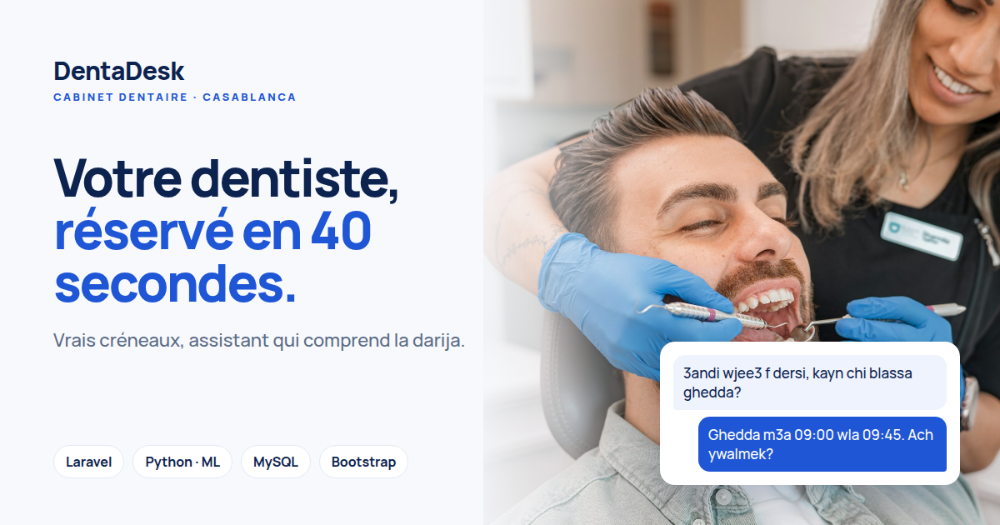

# DentaDesk — cabinet dentaire : site, réservation, dashboard et assistant IA

Un projet complet pour un cabinet dentaire à Casablanca : site vitrine, réservation en
ligne sur de vrais créneaux, dashboard pour la dentiste et la secrétaire, et un assistant
qui comprend la **darija** (en lettres latines ou arabes), le français, l'arabe et l'anglais.

L'assistant tourne sur **un modèle entraîné par nous**, hébergé avec l'application.
Aucune donnée patient n'est envoyée à une API externe.



> Projet de démonstration : le cabinet, la dentiste et les patients sont fictifs.
> Vidéo de démo (2 min) : [post LinkedIn](https://www.linkedin.com/feed/update/urn:li:activity:7518725908128694272/).
> Conçu et développé par Boutayna Metarfi, Master Ingénierie logicielle et Intelligence artificielle.

```
navigateur ──► Laravel 13 (Blade, Bootstrap 5.3, JS, FullCalendar, GSAP)
                 │  moteur de créneaux · dialogue · auth · API JSON
                 ├──► MySQL 8
                 └──► nlu (Python 3.12, FastAPI, scikit-learn)  /parse  /faq  /interpret
```

## Lancer le projet

Il faut seulement Docker (et Node 20+ pour reconstruire le front).

```bash
docker compose up -d                       # app :8000, nlu :8001, mysql :3307
docker compose exec app composer install   # première fois
docker compose exec app php artisan key:generate
docker compose exec app php artisan migrate --seed
cd app && npm install && npm run build
```

- Site : http://localhost:8000
- Dashboard : http://localhost:8000/login
  - `dentiste@dentadesk.test` / `dentadesk2026` (tout voir, schéma dentaire, notes)
  - `secretaire@dentadesk.test` / `dentadesk2026` (accueil : pas de notes médicales)
- Santé du modèle : http://localhost:8001/health

Au premier démarrage, le service `nlu` construit le dataset et entraîne le modèle (une
vingtaine de secondes sur un CPU de portable).

Les données de démo sont générées autour du moment où le seeder tourne : le dashboard
s'ouvre toujours sur une vraie journée (patients terminés, un au fauteuil, la suite).

## Ce qu'il y a dedans

**Site** — hero, barre de réservation (soin → jour → heure → nom + téléphone), soins,
le cabinet, avis, FAQ (lue depuis la base), accès et horaires (lus depuis la base),
assistant en bas à droite. Aucun prix affiché : le devis se fait après l'examen.

**Moteur de créneaux** (`app/app/Booking`) — horaires du jour, moins les pauses, les
congés et les rendez-vous, sur une grille de 15 min, pour la durée du soin. La
réservation verrouille la ligne du praticien (`SELECT … FOR UPDATE`) et revérifie ; un
index unique sur une colonne générée (`slot_lock`, NULL quand le RDV est annulé) est le
dernier filet contre le double booking.

**Assistant** (`app/app/Assistant`) — une machine à états. Le modèle dit ce que le patient
veut ; Laravel décide quoi faire. Les heures proposées et les réponses viennent toujours
de la base, jamais du modèle. Il répond dans le registre du patient (darija latine,
arabe, français, anglais).

**Factures & devis** — la dentiste écrit le contenu (actes de son catalogue de tarifs, dent,
cotation, observations ou plan de traitement), enregistre un brouillon, puis valide : le
document reçoit le numéro suivant de l'année sans trou (F-2026-0042, D-2026-0007), se
verrouille, et garde l'en-tête du jour de sa validation. La secrétaire imprime (A4 ou A5,
« Enregistrer en PDF » depuis le navigateur) et encaisse (espèces, carte, chèque,
virement, paiements partiels). Un document validé ne se supprime pas, il s'annule avec un
motif. Un devis accepté devient une facture en un clic. Montant en toutes lettres :
« Arrêtée la présente facture à la somme de : mille deux cents dirhams ». En-tête et pied
de page configurables (logo, INPE, ICE, IF, patente, RIB, mentions, couleur). Les feuilles
de soins CNSS / CNOPS restent sur papier, remplies à la main.

**Statistiques** (dentiste) — encaissé et facturé, reste à encaisser, panier moyen, taux
de remplissage (temps réservé / temps d'ouverture) et par jour, taux d'absence, nouveaux
patients, délai moyen avant rendez-vous, conversion de l'assistant, provenance des
rendez-vous, soins les plus demandés, encaissé par semaine.

**Équipe** (dentiste) — créer, modifier, désactiver, réactiver ; supprimer seulement un
compte sans historique (sinon on désactive). Un compte désactivé est déconnecté tout de
suite. Journal des actions sensibles.

**Messages** — messagerie interne dentiste ↔ secrétariat, avec le patient concerné en
lien, messages rapides, lu / non lu, badge mis à jour tout seul.

**Dashboard** — Aujourd'hui (programme, statuts, demandes, patient au fauteuil + schéma
dentaire), explication de chaque message patient en français ou en anglais (voir plus bas), Agenda (glisser-déposer, création, fermetures), Demandes (confirmer, refuser,
accepter un déplacement, transformer une question en FAQ), Patients, Assistant AI
(santé du modèle, intentions, corrections), Horaires & soins.

## L'IA, en détail

| Brique | Méthode | Pourquoi |
|---|---|---|
| Intention (12 classes) | TF-IDF n-grammes de caractères 2–5 + régression logistique | la darija s'écrit de dix façons : `3andi`, `andi`, `عندي` partagent leurs n-grammes |
| Entités | règles + lexique (`ghedda`, `nhar jem3a`, `f l3chiya`, `m3a jouj w nos`, `wjee3`…) | une date réservée ne doit jamais être une supposition |
| FAQ | similarité cosinus sur la FAQ validée du cabinet, seuil 0,45 | domaine médical : pas de génération libre |
| Décision | trois niveaux de confiance | le modèle sait quand il doute |

Résultats sur **126 phrases de test écrites à la main** (dont 21 en anglais), jamais vues à l'entraînement
(`nlu/reports/metrics.md`) :

| représentation | F1 validation croisée (5 plis groupés par gabarit) | F1 test |
|---|---|---|
| mots 1–2 | 0,584 | 0,789 |
| **caractères 2–5** | **0,665** | **0,844** |
| mots + caractères | 0,646 | 0,841 |

| niveau | confiance | part du test | ce que fait l'assistant | justesse |
|---|---|---|---|---|
| agit seul | ≥ 0,76 | 52 % | répond / réserve | 98 % |
| demande confirmation | 0,36 – 0,76 | 37 % | propose 3 boutons | bonne réponse parmi les 3 : 96 % |
| passe la main | < 0,36 | 10 % | crée une demande pour le cabinet | — |

Exactitude globale 84,1 %. Avant l'ajout de l'anglais : 86,7 % sur les 105 phrases
d'origine, et 70 % des messages traités seuls. L'anglais (15/21 justes) a rendu le modèle
plus prudent : il demande confirmation plus souvent plutôt que de se tromper.

**Expliquer la darija à la dentiste.** Un médecin venu d'ailleurs ne lit pas forcément
« 3andi wjee3 f dersi mn lbare7 ». Aucun modèle libre ne traduit bien la darija en
lettres latines vers le français ou l'anglais (les modèles Terjman d'AtlasIA vont dans
l'autre sens, anglais → darija). Sous chaque message, le dashboard affiche donc :

- une phrase construite à partir de ce que le modèle a compris (intention, jour, moment,
  soin), en français ou en anglais au choix : « The patient reports pain and wants to be
  seen as soon as possible, for Thursday 22 October in the morning. » ;
- un glossaire des mots darija reconnus (`wjee3` douleur / pain, `dersi` ma molaire / my
  molar, `mn lbare7` depuis hier / since yesterday…), 60 entrées dans `nlu/dentadesk_nlu/glossary.py`.

Ce n'est pas une traduction et le dashboard ne le présente pas comme telle : rien n'est
inventé, et le message d'origine reste affiché au-dessus.

**Boucle d'amélioration.** Dans *Assistant AI*, l'équipe corrige une intention mal
comprise. Ensuite :

```bash
docker compose exec app php artisan nlu:export      # corrections -> nlu/data/corrections.jsonl
docker compose exec nlu sh -c "python data/build_dataset.py && python -W ignore train.py"
docker compose restart nlu                            # charge la nouvelle version
```

Une expérience ratée, gardée volontairement : ajouter les variantes de la FAQ comme
exemples `question_faq` a fait baisser le test de 0,867 à 0,857 (« kayn parking ? » est
une question de FAQ mais une intention `adresse`). Seules les corrections humaines sont
exportées.

## Tests

```bash
docker compose exec app php artisan test                 # 65 tests : créneaux, dialogue, factures, équipe, stats, messages
docker compose exec nlu python -W ignore -m pytest -q    # 56 tests : entités (4 langues), API, FAQ, glossaire
```

## Choix et limites

- Un seul praticien actif ; le schéma en accepte plusieurs.
- WhatsApp : liens `wa.me` pré-remplis. Les rappels automatiques (API Meta) sont prévus en v2.
- `php artisan serve` sert l'app en développement ; en production, mettre PHP-FPM + Nginx
  derrière un VPS (le service Python demande plus qu'un hébergement mutualisé).
- Photos : Unsplash (licence libre), sources dans `app/public/img/SOURCES.json`.

---

Conçu et développé par [@boutayna_metarfi](https://instagram.com/boutayna_metarfi).
Projet de démonstration : le cabinet, la dentiste et les patients sont fictifs.
